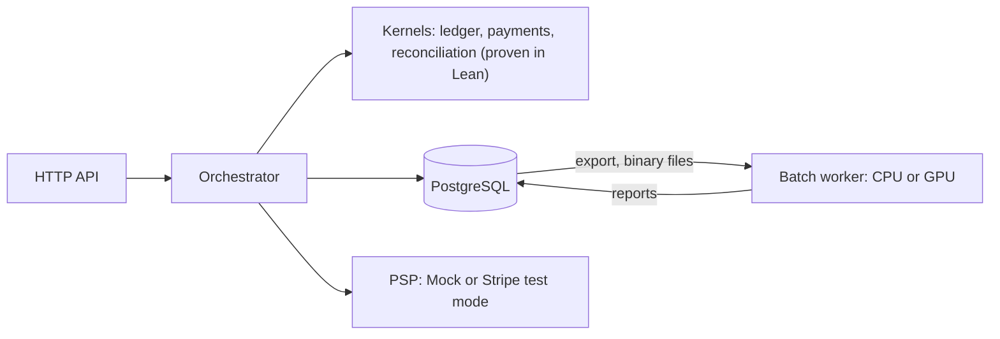
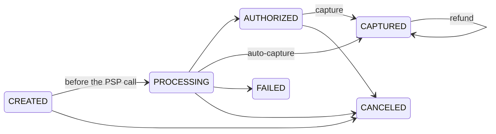

# h5i-pay

Payments, a double-entry ledger and PSP reconciliation on
[h5i-app](https://github.com/h5i-dev/h5i), with the decisions that move
money proven in Lean 4.

## What it is

The kernels are extracted to Lean and proven; the rest is ordinary Rust.
Synthetic funds only, no card numbers.





## Quick start

```bash
export DATABASE_URL=$(scripts/dev-db.sh)   # PostgreSQL 17 in Docker on 127.0.0.1:55432
export H5I_APP_SECRET=dev-user-secret H5I_PAY_OPERATOR_SECRET=dev-operator-secret
cargo build -p payment-api --features mock-psp
target/debug/h5i-pay &                      # http://127.0.0.1:8080, Mock PSP
```

## Use

```bash
MERCHANT=$(H5I_APP_ISSUE=1:7 target/debug/h5i-pay)   # a token for tenant 1, user 7
api() { curl -s -H "Authorization: Bearer $MERCHANT" -H 'content-type: application/json' -d "$2" localhost:8080$1; echo; }
api /v1/payments '{"amount":1200,"currency":"jpy","capture":"manual","payment_method":"tok_visa"}'
api /v1/payments/0/capture '{"amount":1000}'
api /v1/payments/0/refunds '{"amount":300}'
```

## Verified

- Ledger: money is conserved, the journal balances, `no_overdraft` accounts never overdraw.
- Payments: only allowed steps, refunds ≤ capture, each webhook applied once, every change in the history.
- Trusted: Charon, Aeneas, Lean, PostgreSQL, HTTP and auth, the PSP, the clock ([details](docs/proof-assumptions.md)).

## Performance

AWS g5.xlarge, 100k-payment tenant, 2026-11-03 ([details](docs/benchmarks.md)).

| Measured | Result |
|---|---:|
| Payments over HTTP, 32 clients | 186 /s |
| `POST /v1/payments`, p50 | 16.7 ms |
| Batch reconciliation, 10M rows/side, GPU vs 4 CPU threads, long-lived | 144 vs 663 ms (4.6×) |
| The same, one-shot | 341 vs 700 ms (2.1×) |

## Docs

[API](docs/api.md) · [Development](docs/development.md) · [Design](docs/design-v0.1.md) · [Batch files](docs/batch-files.md) · [Benchmarks](docs/benchmarks.md) · [Proofs](docs/proof-assumptions.md) · [Failure recovery](docs/failure-recovery.md) · [Deploy](infra/README.md) · [Security](docs/security-review.md) · [Compliance](docs/compliance.md) · [Runbooks](docs/runbooks/README.md) · [Progress](docs/PROGRESS.md)

## License

Apache-2.0.
